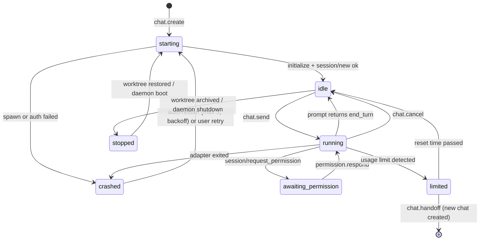

# Agentdeck — Technical Specification & Implementation Plan

> Source of truth: the [Agentdeck spec doc](https://claude.ai/artifact/E9gkgcyhW2XNyMYmtFYBq1) (Sumeet Rohra, 2026-10-04). This file is a snapshot of it; edit the doc first, then re-sync here.

Companion to the product PRD (not yet checked in). Each phase is written so it can be handed to a coding agent as a standalone unit.

## Overview

One TypeScript monorepo produces three deployables: a daemon on the user's machine, a relay on Cloudflare, and an Expo app for iOS, Android and web. They share one protocol package, so a message type changes in one place and all three fail to compile until they agree.

| Layer | Choice | Why |
|---|---|---|
| Language | TypeScript, `strict`, ESM everywhere | One language across all three deployables |
| Monorepo | pnpm workspaces + Turborepo | Cached builds, per-package tasks |
| Schemas | Zod, with types inferred from schemas | Runtime validation at every trust boundary |
| Daemon runtime | Node 22 LTS for v1; single binary later | `node-pty` and `better-sqlite3` are native addons and are proven on Node |
| Daemon storage | SQLite via `better-sqlite3`, WAL mode; Drizzle ORM for migrations | Single file, zero setup, fast |
| Agent interface | ACP TypeScript SDK as client; adapters `claude-agent-acp`, `codex-acp`, `gemini --acp` | Structured events, one integration for many agents |
| Relay | Cloudflare Workers + Durable Objects (SQLite storage, WebSocket hibernation) | One object per user, cheap idle connections |
| Crypto | libsodium (`libsodium-wrappers-sumo` on Node and web, `react-native-libsodium` on mobile) | Same primitives on every platform |
| Mobile | Expo SDK (current), Expo Router, TanStack Query, Zustand, MMKV | Matches existing React skills; web build doubles as the desktop UI |
| Code and diff rendering | Shiki in a WebView on native, direct on web | Correct highlighting for every language |
| Tests | Vitest, Playwright (web UI), Maestro (mobile flows) | Fast unit tests, real end-to-end flows |

Pin exact versions when Phase 0 starts. Package names in the ACP ecosystem have moved before, so confirm them against the ACP registry.

```
agentdeck/
  packages/
    protocol/        # zod schemas: envelope, commands, events, errors
    crypto/          # pairing, key exchange, frame encrypt/decrypt
    shared/          # ids, time, result types, logger interface
  apps/
    daemon/          # Node service on the user's machine
    relay/           # Cloudflare Worker + Durable Objects
    mobile/          # Expo app (iOS, Android, web)
    cli/             # `agentdeck` CLI: install, pair, profile, debug client
  tools/
    fake-agent/      # scripted ACP agent for tests
  docs/
```

**Conventions**

- **Ids:** ULIDs with a type prefix (`wt_01J…`, `chat_01J…`), so ids sort by creation time and are readable in logs.
- **Time:** milliseconds since epoch as numbers in the protocol; ISO strings only in UI.
- **Errors:** every failure is `{ code, message, retryable, details? }` with a code from one enum in `protocol`.
- **Paths:** stored absolute and normalized; the phone only ever sees paths relative to a repo or worktree root.
- **Logging:** structured JSON lines (pino) with `traceId` per command; never log message content or file contents.

## Protocol

Clients send commands and get exactly one reply each; the daemon pushes events on topics the client subscribed to. Every frame is JSON inside an encrypted envelope; the relay only reads the outer routing header.

### Envelope

```ts
// Outer frame: visible to the relay
type RelayFrame = {
  v: 1;
  to: DeviceId;            // recipient device
  from: DeviceId;
  seq: number;             // per (from,to) counter, also the nonce input
  kind: "msg" | "ack" | "ping";
  body: string;            // base64 ciphertext of an Inner frame
};

// Inner frame: only phone and daemon can read
type Inner =
  | { t: "cmd";   id: CmdId; name: CommandName; args: unknown }
  | { t: "res";   id: CmdId; ok: true;  data: unknown }
  | { t: "res";   id: CmdId; ok: false; error: ProtocolError }
  | { t: "evt";   topic: Topic; cursor: number; event: DaemonEvent }
  | { t: "blob";  blobId: string; part: number; last: boolean; bytes: string };

type ProtocolError = {
  code: ErrorCode;         // e.g. NOT_FOUND, CONFLICT, AGENT_LIMIT, AGENT_CRASHED, FORBIDDEN_PATH
  message: string;
  retryable: boolean;
  details?: Record<string, unknown>;
};
```

### Commands

| Command | Args | Returns |
|---|---|---|
| `sync.hello` | `{ deviceName, appVersion, cursors: Record<Topic, number> }` | daemon info, missed events streamed after |
| `repo.list` / `repo.add` / `repo.remove` | `{ path }` for add | `Repo[]` / `Repo` |
| `fs.browse` | `{ root: "allowlist", path }` | folders only, for adding repos |
| `profile.list` / `profile.create` / `profile.remove` | `{ agent, name }` | `Profile` |
| `profile.loginStatus` | `{ profileId }` | `{ loggedIn, account? }` |
| `worktree.list` | `{ repoId }` | `Worktree[]` |
| `worktree.create` | `{ repoId, baseRef, branch, title }` | `Worktree` (status `creating`) |
| `worktree.archive` / `restore` / `delete` | `{ worktreeId }` | `Worktree` |
| `chat.create` | `{ worktreeId, agent, profileId, mode?, model? }` | `Chat` |
| `chat.send` | `{ chatId, text, attachments?: BlobRef[] }` | `{ turnId }` |
| `chat.cancel` | `{ chatId }` | `{}` |
| `chat.handoff` | `{ chatId, toProfileId, toAgent? }` | new `Chat` |
| `permission.respond` | `{ chatId, requestId, decision: "allow_once" \| "allow_always" \| "deny", message? }` | `{}` |
| `diff.summary` | `{ worktreeId, against?: "base" \| "head" }` | files with +/- counts |
| `diff.file` | `{ worktreeId, path }` | blob with unified diff |
| `fs.tree` / `fs.read` / `fs.search` | `{ worktreeId, path?, query? }` | entries / blob / matches |
| `preview.start` / `preview.stop` | `{ worktreeId, script? }` | `{ url, expiresAt }` |
| `proc.tail` | `{ procId, from? }` | stream on topic `proc:<id>` |
| `git.commit` / `git.push` / `git.pr` / `git.mergeToBase` | `{ worktreeId, message?, title?, body? }` | result |
| `blob.put` | `{ mime, size }` then `blob` frames | `BlobRef` |
| `device.list` / `device.revoke` | `{ deviceId }` | `Device[]` |

### Events

```ts
type Topic = "global" | `repo:${RepoId}` | `chat:${ChatId}` | `proc:${ProcId}`;

type DaemonEvent =
  | { type: "worktree.updated"; worktree: Worktree }
  | { type: "chat.status"; chatId: ChatId; status: ChatStatus }
  | { type: "chat.item"; chatId: ChatId; item: ChatItem }        // appended
  | { type: "chat.itemPatch"; chatId: ChatId; itemId: string; patch: Partial<ChatItem> } // streaming text, tool progress
  | { type: "permission.requested"; chatId: ChatId; request: PermissionRequest }
  | { type: "usage.updated"; profileId: ProfileId; usage: UsageSnapshot }
  | { type: "proc.output"; procId: ProcId; chunk: string }
  | { type: "preview.status"; worktreeId: WorktreeId; status: "starting" | "ready" | "crashed" | "stopped"; url?: string };

type ChatItem =
  | { kind: "user"; id: string; text: string; attachments: BlobRef[]; at: number }
  | { kind: "agent_text"; id: string; text: string; at: number }
  | { kind: "thought"; id: string; text: string; at: number }
  | { kind: "tool"; id: string; title: string; toolKind: string; status: "pending" | "running" | "done" | "failed"; locations?: string[]; diff?: BlobRef }
  | { kind: "plan"; id: string; entries: { text: string; status: "pending" | "in_progress" | "done" }[] }
  | { kind: "system"; id: string; text: string; level: "info" | "warn" | "error" };
```

### Delivery rules

- **Resume:** each topic keeps a monotonic `cursor`. `sync.hello` carries the client's last cursor per topic, and the daemon replays everything after it from the event log before going live.
- **Idempotency:** `CmdId` is a client ULID. The daemon stores results for 24 hours, and a repeated `CmdId` returns the stored result without running again.
- **Ordering:** events within a topic are strictly ordered; across topics there is no ordering promise.
- **Streaming text:** `chat.itemPatch` frames are coalesced to at most 20 per second per chat to keep relay traffic low.
- **Size:** inner frames above 64 KB go as blobs in 256 KB parts.

## Data model

SQLite holds metadata; chat history lives in append-only JSONL files that double as the replay log. Losing the database never loses a conversation.

```sql
CREATE TABLE repos (
  id TEXT PRIMARY KEY, path TEXT UNIQUE NOT NULL, name TEXT NOT NULL,
  default_base TEXT NOT NULL DEFAULT 'main', config_json TEXT,  -- parsed .agentdeck/config.json
  created_at INTEGER NOT NULL
);

CREATE TABLE profiles (
  id TEXT PRIMARY KEY, agent TEXT NOT NULL,          -- 'claude' | 'codex' | 'gemini' | ...
  name TEXT NOT NULL, config_dir TEXT NOT NULL,       -- isolated folder
  color TEXT, created_at INTEGER NOT NULL,
  UNIQUE(agent, name)
);

CREATE TABLE worktrees (
  id TEXT PRIMARY KEY, repo_id TEXT NOT NULL REFERENCES repos(id),
  title TEXT NOT NULL, branch TEXT NOT NULL, base_ref TEXT NOT NULL,
  path TEXT UNIQUE NOT NULL,
  status TEXT NOT NULL,                               -- creating | setting_up | ready | setup_failed | archived
  port INTEGER UNIQUE,                                -- assigned preview port
  created_at INTEGER NOT NULL, archived_at INTEGER
);

CREATE TABLE chats (
  id TEXT PRIMARY KEY, worktree_id TEXT NOT NULL REFERENCES worktrees(id),
  agent TEXT NOT NULL, profile_id TEXT NOT NULL REFERENCES profiles(id),
  acp_session_id TEXT,                                -- for session/load on resume
  title TEXT, status TEXT NOT NULL,                   -- see lifecycle
  last_cursor INTEGER NOT NULL DEFAULT 0,
  created_at INTEGER NOT NULL, updated_at INTEGER NOT NULL
);

CREATE TABLE permission_rules (                       -- 'allow always' per chat
  chat_id TEXT NOT NULL REFERENCES chats(id), tool_kind TEXT NOT NULL, pattern TEXT,
  PRIMARY KEY (chat_id, tool_kind, pattern)
);

CREATE TABLE usage_samples (
  profile_id TEXT NOT NULL, at INTEGER NOT NULL,
  input_tokens INTEGER, output_tokens INTEGER, limit_hit INTEGER NOT NULL DEFAULT 0, reset_at INTEGER
);

CREATE TABLE devices (
  id TEXT PRIMARY KEY, name TEXT NOT NULL, public_key BLOB NOT NULL,
  paired_at INTEGER NOT NULL, last_seen_at INTEGER, revoked_at INTEGER
);

CREATE TABLE command_results (                        -- idempotency, 24h TTL
  cmd_id TEXT PRIMARY KEY, device_id TEXT NOT NULL, result_json TEXT NOT NULL, at INTEGER NOT NULL
);

CREATE TABLE topic_cursors (topic TEXT PRIMARY KEY, cursor INTEGER NOT NULL);
```

On-disk layout, under the OS's app data folder (`~/Library/Application Support/agentdeck`, `~/.local/share/agentdeck`, `%APPDATA%\agentdeck`):

```
agentdeck/
  agentdeck.db                    # SQLite, WAL
  keys/daemon.key                 # encrypted with an OS-keystore secret
  profiles/<profileId>/           # CLAUDE_CONFIG_DIR / CODEX_HOME for that profile
  shared/                         # MCP config, skills, global instructions, linked into profiles
  events/<topic>.jsonl            # append-only, one event per line, cursor = line number
  blobs/<sha256>                  # attachments and large diffs, content-addressed
  logs/daemon-YYYY-MM-DD.jsonl
worktrees live next to each repo by default: <repo>/../.agentdeck-worktrees/<repo-name>/<branch>
```

Event logs rotate at 50 MB per topic. The older half is compacted into a snapshot of chat items, so replay stays fast.

## Daemon

The daemon is a set of small modules behind one command router. Transports (relay, localhost) only deliver decrypted commands to the router, so every feature is testable without a network.

```
apps/daemon/src/
  main.ts                 # boot: config, db, migrations, modules, transports
  router.ts               # CommandName -> handler, zod validation, idempotency, errors
  bus.ts                  # topic event bus + JSONL event log + cursors
  transports/
    relay.ts              # outbound WS to relay, reconnect with backoff, frame crypto
    local.ts              # localhost HTTP+WS for the desktop web UI (token in a 0600 file)
  modules/
    repos.ts              # add/remove, allow-list, config parsing
    profiles.ts           # folders, env per agent, shared-folder linking, login status
    worktrees.ts          # git worktree add/remove, setup/teardown scripts, ports
    sessions/
      manager.ts          # one AgentSession per chat, spawn, restart, resume
      acp-client.ts       # ACP client side: initialize, session/new|load|prompt|cancel
      mapper.ts           # ACP session/update -> ChatItem / itemPatch
      permissions.ts      # broker: rules, pending requests, push trigger
      agents.ts           # registry: claude, codex, gemini -> command, args, env keys
    git.ts                # status, diff, commit, push, gh pr, merge to base
    files.ts              # tree, read (chunked), ripgrep search, path jail
    procs.ts              # node-pty processes, ring buffers, kill trees
    preview.ts            # dev server lifecycle + preview channel to relay
    usage.ts              # usage samples, limit detection
    notify.ts             # decides when to send a push wake-up
    devices.ts            # pairing, revoke
```

### Agent registry

```ts
type AgentSpec = {
  id: "claude" | "codex" | "gemini" | string;
  displayName: string;
  command: string[];                       // e.g. ["claude-agent-acp"] or ["npx", "-y", "@zed-industries/codex-acp"]
  profileEnv: (dir: string) => Record<string, string>; // claude: { CLAUDE_CONFIG_DIR: dir }, codex: { CODEX_HOME: dir }
  loginCommand: string[];                  // run in a desktop terminal with profileEnv applied
  detectLimit: (err: unknown, text?: string) => { hit: boolean; resetAt?: number };
};
```

### ACP integration

The daemon is the ACP client. For each chat it spawns the adapter with `cwd` set to the worktree and the profile's env, then talks JSON-RPC over stdio.

1. `initialize` with client capabilities: file read and write inside the worktree, terminals off for v1. The agent's own tools run commands.
2. `session/new` with `cwd` = worktree path and the MCP servers from the shared config. Store the returned session id in `chats.acp_session_id`.
3. `session/prompt` per `chat.send`, with text plus image content blocks for attachments.
4. `session/update` notifications go through `mapper.ts`: message chunks become `agent_text` patches, tool calls become `tool` items, plans become `plan` items.
5. `session/request_permission` from the agent goes to `permissions.ts`. If a saved rule matches it is answered at once; otherwise a `permission.requested` event and a push go out, and the reply waits for `permission.respond`.
6. `fs/read_text_file` and `fs/write_text_file` requests from the agent are served from disk inside the path jail.
7. `chat.cancel` sends `session/cancel`.
8. On daemon restart, if the adapter advertised `loadSession`, call `session/load` with the stored id; otherwise start a fresh session seeded with a transcript summary and mark the chat "resumed".

Exact method names and capability flags come from the ACP spec version pinned in Phase 0.

### Worktrees and processes

- **Create:** `git worktree add -b <branch> <path> <baseRef>`, then run `setup` scripts from `.agentdeck/config.json` with env `AGENTDECK_WORKTREE`, `AGENTDECK_PORT`, `AGENTDECK_REPO_ROOT`. Status goes `creating → setting_up → ready | setup_failed`.
- **Ports:** a pool from a configurable range (default 41000-41999), one per worktree, released on archive.
- **Processes:** every child goes in a process group (Unix) or job object (Windows) so stop kills the whole tree. Output is kept in a 1 MB ring buffer.
- **Path jail:** every file path is resolved with `realpath` and must stay under its worktree root; `.git` internals and configured secret globs (`.env*`, `*.pem`) are hidden by default.

## Chat lifecycle

A chat is idle or blocked most of the time; the phone mainly needs to know when it moves into `awaiting_permission`, `idle` after a turn, `limited` or `crashed`, because those four send a push.



Rules:

- `chat.send` while `running` or `awaiting_permission` is queued and sent when the chat returns to `idle`. The phone shows it as "queued".
- A pending permission request survives a phone disconnect; it never times out on its own, because agents wait.
- Push is sent on entering `awaiting_permission`, `limited` or `crashed`, and on `running → idle` if no client has had the chat open in the last 30 seconds.

## Relay

The relay is a dumb, durable mailbox: one Durable Object per account holds every device's WebSocket, forwards sealed frames, buffers for offline devices, and fires push wake-ups. It never holds a key that can open a message.

### Endpoints (Worker)

| Method + path | Auth | Purpose |
|---|---|---|
| `POST /v1/auth/start` | none | Email magic link or GitHub OAuth start |
| `POST /v1/auth/finish` | code | Returns account session token (JWT, 30 days, rotating) |
| `POST /v1/pair/offer` | daemon token | Daemon registers a one-time pairing id (TTL 10 min) |
| `POST /v1/pair/claim` | account session | Phone claims the id; relay joins both devices to the account |
| `GET /v1/ws?device=<id>` | device token | Upgrade to WebSocket, routed to the account's Durable Object |
| `POST /v1/push/register` | device token | Store Expo push token for this device |
| `GET /v1/devices` / `DELETE /v1/devices/:id` | account session | List and revoke (revocation also needs the daemon's signed confirmation) |
| `*.preview.<domain>` | signed preview token | Preview traffic, see Preview tunnelling |

### Durable Object `AccountHub`

- **Connections:** WebSocket Hibernation API; each socket tagged with its device id, so idle connections cost almost nothing.
- **Routing:** on a `msg` frame, check that `from` matches the socket and `to` belongs to this account. Forward if the target is connected; otherwise store it.
- **Buffer:** SQLite storage in the object, max 1,000 frames or 10 MB per target device, 7-day TTL, oldest dropped first with a `gap` marker. The daemon's own event log makes a gap recoverable through `sync.hello`.
- **Acks:** recipients ack by `seq`; acked frames are deleted.
- **Push:** when a frame arrives for a phone that isn't connected and the inner frame is marked `wake` (an unencrypted flag the daemon sets on permission, limit, crash and turn-end events), call the Expo push API with a fixed body like "Agentdeck: a session needs you". No content goes in the push.
- **Limits:** 50 frames/second and 2 MB/second per device; daemons get a larger budget for blobs.

### Self-host

`apps/relay` also builds a Node version (Hono + `ws` + SQLite) with the same routes, shipped as a Docker image. The daemon and app take a relay URL setting.

## Pairing and encryption

> **Superseded in Phase 2c.** QR pairing below was replaced by signing in: consumers sign in with
> Firebase Auth, computers link with `agentdeck login`, and the account's device list on the relay
> is the trust root. Sessions and frame encryption are unchanged. See
> [`phase-2.md`](phase-2.md#2c-sign-in-many-hosts-many-consumers).

Each phone-daemon pair shares symmetric keys derived from a key exchange done during QR pairing. The relay can see who talks to whom, when, and how much, but not what.

### Keys

- **Device identity:** X25519 key pair per device (`crypto_kx_keypair`), plus an Ed25519 signing key pair (`crypto_sign_keypair`) for revocation and pairing signatures.
- **Storage:** private keys sealed with a random secret kept in the OS keystore: macOS Keychain, Windows DPAPI, libsecret on Linux (falling back to a 0600 file with a warning), Expo SecureStore on phones.
- **Session keys:** `crypto_kx_client_session_keys` (phone) and `crypto_kx_server_session_keys` (daemon) give one key per direction. On every new connection both sides generate ephemeral kx key pairs, sign them with their Ed25519 identity keys, and derive the session keys from the ephemerals. A stolen long-term key can impersonate a device later but can't decrypt past sessions.
- **Frames:** `crypto_aead_xchacha20poly1305_ietf_encrypt`. The nonce is 24 random bytes sent with the frame; additional data is `from|to|seq`, binding the ciphertext to its routing header. The receiver rejects any `seq` it has already seen.

### Pairing flow

1. Daemon: `agentdeck pair` calls `/v1/pair/offer` and shows a QR code containing `{ relayUrl, pairingId, daemonDeviceId, daemonKxPub, daemonSignPub, secret }`. `secret` is 32 random bytes that never touch the relay.
2. Phone: scans, signs in to the relay if needed, calls `/v1/pair/claim`. Both devices are now on the same account and can exchange frames.
3. Phone sends `pair.hello = { phoneKxPub, phoneSignPub, mac }`, where `mac = HMAC(secret, phoneKxPub|phoneSignPub)`. Only someone who saw the QR code can produce it.
4. Daemon verifies `mac`, stores the phone as a device, and replies `pair.ok` signed with its sign key.
5. Both sides show a 6-digit short code derived from the transcript hash; the user confirms they match on desktop and phone. This guards against a QR code photographed off-screen.

### Revocation

`device.revoke` from any paired device: the daemon marks the device revoked, refuses its frames, rotates nothing else (keys are per pair), and tells the relay to drop the device's sockets and push token.

Unencrypted metadata, stated plainly in the security page: device ids, frame sizes and times, and the `wake` flag on push-worthy frames.

## Preview tunnelling

Preview traffic uses a separate, TLS-only channel through the relay. A WebView can't take part in the end-to-end session, so v1 trades end-to-end encryption for a preview that works with real dev servers. It is off by default per repo.

**URL scheme:** `https://<token>.preview.<domain>/`, one subdomain per running preview. Using a subdomain rather than a path prefix keeps absolute URLs like `/assets/app.js` working without rewriting.

**Token:** 128-bit random, mapped in the account's Durable Object to `{ worktreeId, daemonDeviceId, allowedDeviceId, expiresAt }`. Default lifetime is 8 hours. The first load must carry a one-time `?k=` code from the app, which is swapped for an HttpOnly cookie, so a forwarded URL is useless on another device.

**Request path:**

1. The phone's WebView requests `https://<token>.preview…/page`.
2. A Worker on the wildcard route finds the account by token and forwards to the Durable Object.
3. The object sends a `preview.req` frame on the daemon's socket: `{ reqId, method, path, headers, bodyChunks }`.
4. The daemon's `preview.ts` fetches `http://127.0.0.1:<port><path>` and streams `preview.res` frames back: status, headers, then body chunks.
5. The object streams the response to the WebView.

**WebSockets (hot reload):** an upgrade on the preview host opens a `preview.ws` sub-channel through the same daemon socket. Frames are relayed both ways.

**Dev-server env:** when starting a preview the daemon sets `PORT`, `HOST=127.0.0.1`, plus framework hints in the repo config, for example `VITE_HMR_CLIENT_PORT=443`, `NEXT_PUBLIC_URL`, `ALLOWED_HOSTS`. Repos can add their own in `.agentdeck/config.json`.

**Limits:** 25 MB per response, 60 s idle timeout, and a per-account monthly preview bandwidth cap on the hosted relay.

**v2, end-to-end preview:** an in-app proxy on the phone (`127.0.0.1:<n>` served by native code) that decrypts preview frames from the end-to-end channel and serves them to the WebView.

## Mobile app

The app is a thin, cache-first client: every screen renders from local cache immediately, then live events correct it. All state comes from the daemon; nothing is computed on the phone except layout.

### Routes (Expo Router)

```
app/
  (onboarding)/sign-in.tsx, pair.tsx (QR scanner), confirm-code.tsx
  (main)/
    index.tsx                         # machines + repos, status badges
    repo/[repoId]/index.tsx           # worktrees list, "New task" FAB
    repo/[repoId]/new.tsx             # title, base, agent, profile, first message, attachments
    wt/[worktreeId]/_layout.tsx       # top tabs: Chats | Changes | Files | Preview | Logs
    wt/[worktreeId]/chats.tsx
    wt/[worktreeId]/chat/[chatId].tsx
    wt/[worktreeId]/changes.tsx       # diff summary -> file diff
    wt/[worktreeId]/files/[...path].tsx
    wt/[worktreeId]/preview.tsx       # react-native-webview
    wt/[worktreeId]/logs.tsx
    profiles.tsx, devices.tsx, settings.tsx
```

### State

- **Connection layer** (`lib/conn.ts`): one encrypted socket per paired machine, reconnect with backoff, `sync.hello` with stored cursors, command queue persisted in MMKV while offline.
- **Server state:** TanStack Query keyed by command + args; event handlers write straight into the query cache, so lists update without refetching.
- **Chat store:** a normalized Zustand store per open chat (`items`, `order`, `pendingPermission`, `queuedMessages`), backed by MMKV so a cold start shows the last 200 items instantly.
- **UI state:** Zustand, not persisted.

### Key components

- **ChatList:** FlashList, inverted, with item renderers per `ChatItem.kind`. Tool cards collapse by default, and diffs open in a sheet.
- **PermissionSheet:** bottom sheet pinned above the composer while a request is pending, with Allow once, Always, Deny, and Deny + message. Haptic on arrival.
- **Composer:** multiline input, attach (camera, library, clipboard image paste), agent mode picker, send or queue.
- **CodeView / DiffView:** a single reused WebView that loads a local HTML bundle with Shiki; content is passed in by `postMessage`. It handles large files with virtualized lines.
- **PreviewView:** WebView with URL bar, reload, back, and a width toggle (phone, tablet, desktop emulation via viewport meta injection).

### Notifications

Expo Notifications. Tapping a push opens the app, which reconnects, syncs, and deep-links to the chat with the newest pending event. The push itself carries no content.

### Desktop web

The same app built with `expo export --platform web` and served by the daemon at `http://127.0.0.1:<port>`. It connects over the local transport, so no relay or encryption is needed on the same machine. A responsive layout shows a three-column view (worktrees, chat, changes) above 1024 px.

## Packaging and OS specifics

v1 ships the daemon as an npm package (`npm i -g agentdeck`, Node 22+), because native addons make single-binary builds fragile. Native installers follow once the build is stable.

| Concern | macOS | Linux | Windows |
|---|---|---|---|
| Install, v1 | npm global; Homebrew tap later | npm global; `.deb`/`.rpm` later | npm global; winget/MSI later |
| Background service | launchd agent `~/Library/LaunchAgents/dev.agentdeck.plist` | systemd user unit, `loginctl enable-linger` hint | Scheduled task at logon, or a small service via `node-windows` |
| Keep awake | `caffeinate -i` while chats run (setting) | `systemd-inhibit` while chats run | `SetThreadExecutionState` via a tiny helper |
| Key storage | Keychain via `@napi-rs/keyring` | libsecret, file fallback | DPAPI via keyring |
| Process groups | `detached` + negative pid kill | same as macOS | Job objects via `node-pty`'s ConPTY; `taskkill /T` fallback |
| Agent credential gotcha | Claude Code stores tokens in Keychain; verify per-`CLAUDE_CONFIG_DIR` isolation | Credentials in config dir | Credentials in config dir |
| Paths | case-insensitive FS by default | case-sensitive | backslashes, 260-char limit: enable long paths; worktrees under a short root |
| Editor open | `zed`, `code`, `cursor` CLIs | same | same, `.cmd` shims |

**CLI** (`apps/cli`, installed with the daemon):

```
agentdeck install        # write service file, start daemon, open desktop UI
agentdeck pair           # print QR in terminal + open it in desktop UI
agentdeck profile add claude --name "Claude Work"   # creates folder, runs login in this terminal
agentdeck repo add .
agentdeck status         # chats, profiles, usage, relay connection
agentdeck doctor         # git, gh, agents, adapters, keystore, ports, relay reachability
agentdeck uninstall
```

## Testing, CI and observability

A scripted fake ACP agent makes the whole stack testable without spending tokens. Real agents run only in a nightly smoke test.

| Layer | Tool | What it covers |
|---|---|---|
| Protocol | Vitest + zod fixtures | Every command and event round-trips; old fixtures still parse (compatibility) |
| Crypto | Vitest + libsodium test vectors | Pairing transcript, replay rejection, tampered header rejection, cross-platform decrypt (Node encrypts, RN-compatible build decrypts) |
| Daemon modules | Vitest with temp git repos | Worktree create/setup/archive, path jail escapes, port pool, idempotent commands |
| Sessions | Vitest + `tools/fake-agent` | Scripted ACP runs: streaming, tool calls, permission request, crash, limit error, cancel, session/load |
| Relay | Miniflare / `wrangler dev` tests | Routing, buffering, ack deletion, revocation, rate limits, preview token checks |
| End to end | Playwright on the web build + daemon + local relay | New task → permission → approve → diff → PR (with `gh` stubbed) |
| Mobile | Maestro flows on iOS simulator and Android emulator | Pairing, chat, image attach, push deep link |
| Nightly smoke | Real `claude-agent-acp` and `codex-acp` with test accounts | One short prompt per agent; catches adapter breakage |

**CI (GitHub Actions):** lint, typecheck and unit tests on every PR across macOS, Ubuntu and Windows runners for the daemon; relay tests on Ubuntu; EAS build for mobile on main; Changesets for versioning and npm publish.

**Observability:**

- **Daemon:** JSON logs with command name, duration, error code, never content. `agentdeck doctor --bundle` exports redacted logs for bug reports.
- **Relay:** Workers Analytics Engine for connections, frames, buffer depth, push sends and preview bytes per account (no content possible).
- **App:** Sentry for crashes, with breadcrumbs stripped of message text. Product analytics are opt-in only.
- **SLOs:** relay frame latency p95 under 150 ms within a region; 99.9% monthly relay availability; reconnect to live in under 2 s p95.

## Implementation plan

Six phases, about 14 weeks of focused work to public launch. Each phase lists its tasks as a checklist, the files it touches, and acceptance criteria a reviewer (or a coding agent) can verify. No phase refactors an earlier one's public interfaces; changes to `packages/protocol` are additive only.

### Phase 0: Spikes (2 evenings)

Goal: kill the three biggest unknowns before writing product code.

- Multi-account: two `CLAUDE_CONFIG_DIR` folders, log in to two accounts, run two sessions at once on macOS and on one other OS. Note where credentials land.
- `spikes/acp-client.ts` (~50 lines): spawn `claude-agent-acp` with a profile env, `initialize`, `session/new`, `session/prompt` with text + one PNG, print every `session/update` and answer one permission request.
- Repeat with `codex-acp`; diff the event shapes between the two.
- Durable Object hello world: two WebSockets in one object, hibernation on, message forwarded.
- `react-native-libsodium` encrypt on phone → decrypt with `libsodium-wrappers` on Node.

Acceptance: a short `docs/spikes.md` with the answers, pinned package versions, and the go/no-go on Keychain isolation.

### Phase 1: Daemon core (weeks 1-3)

Goal: everything works from a local CLI client with no relay and no app.

- Monorepo scaffold: pnpm, Turborepo, TS configs, Vitest, lint, CI on three OSes.
- `packages/protocol`: envelope, all P0 commands and events, error codes, fixtures.
- `apps/daemon`: `main.ts`, `router.ts` (validation + idempotency), `bus.ts` (topics, JSONL log, cursors), SQLite schema + migrations.
- `modules/repos.ts`, `profiles.ts` (folders, env, shared linking, login status), `worktrees.ts` (create, setup scripts, archive, ports).
- `modules/sessions/*`: registry, ACP client, mapper, permission broker, restart and `session/load` resume.
- `modules/git.ts` (diff summary and file diff), `files.ts` (tree, read, ripgrep, path jail).
- `transports/local.ts` and `apps/cli` debug client: `agentdeck dev send`, `agentdeck dev watch`.
- `tools/fake-agent` and session tests.

Acceptance:

- From the CLI: add a repo, create two profiles, create a worktree, start one chat per profile, send a prompt with an image, approve a permission, read the diff.
- Kill the daemon mid-turn and restart it: chats come back, the event log replays from any cursor, and no command runs twice.
- Path jail tests reject `../`, symlink escapes and absolute paths.

### Phase 2: Relay, crypto, mobile MVP (weeks 4-7)

Goal: the phone becomes the daily driver for chats.

- `packages/crypto`: key generation, keystore adapters, pairing transcript, frame encrypt/decrypt, test vectors.
- `apps/relay`: auth (magic link + GitHub), pair offer/claim, `AccountHub` routing, buffering, acks, push via Expo, rate limits; deploy to staging.
- `transports/relay.ts`: outbound socket, reconnect, `sync.hello`, wake flags.
- `apps/mobile`: onboarding + QR pairing + short-code confirm; repos → worktrees → chats; chat screen with streaming, tool cards, plan, permission sheet, composer with image attach; new-task flow; push and deep links; offline cache and command queue.
- `agentdeck pair`, `agentdeck install` (launchd, systemd, scheduled task).

Acceptance:

- Pair a phone on mobile data with a daemon behind home NAT in under 2 minutes.
- Start a task from the phone, get a permission push with the app closed, approve it from the lock screen deep link, and see the turn finish.
- With the phone in airplane mode for 10 minutes while an agent works, reconnecting shows every event in order with no gaps.
- Relay database dump contains no plaintext message content (automated check).
- Gate: you ship one real change from the phone.

### Phase 3: Review, code, preview (weeks 8-10)

Goal: you can judge and test an agent's work without a laptop.

- Changes tab: diff summary, file diff in DiffView, "comment on line → send to chat".
- Files tab: tree, fuzzy file search, ripgrep search, CodeView with line links.
- `modules/procs.ts` + Logs tab: start scripts, live output, stop.
- `modules/preview.ts` + relay preview routes + Preview tab, including the WebSocket sub-channel and per-repo env hints.
- `modules/git.ts`: commit, push, `gh pr create`, merge to base; PR sheet in the app.
- Desktop web build served by the daemon; "Open in Zed / VS Code / Cursor".

Acceptance:

- A Vite app and a Next.js app both load in Preview with hot reload working.
- Opening a 5,000-line file scrolls smoothly on a mid-range Android phone.
- PR created from the phone appears on GitHub with the agent-drafted body.
- Gate: closed beta with 50 users.

### Phase 4: Accounts power and launch (weeks 11-14)

Goal: multi-account is a feature, not a workaround, and the product is installable by strangers.

- `modules/usage.ts`: usage samples from ACP or adapter output, limit detection per agent, `usage.updated` events; profile usage view in the app.
- `chat.handoff`: summarize the transcript, start a chat on another profile or agent with the summary and the same worktree.
- Shared config linking (MCP, skills, global instructions) with per-profile overrides.
- Windows hardening: long paths, ConPTY, job objects, scheduled-task service, keep-awake helper.
- Billing on the hosted relay (Stripe; plan limits enforced in `AccountHub`), self-host Docker image, open-source repo prep (licence, contributing, security policy).
- Store submissions (iOS, Android), landing page, docs site.

Acceptance:

- Hitting a limit on one profile offers hand-off, and the new chat continues the task in the same worktree.
- Fresh install to first phone-started chat in under 5 minutes on all three OSes, measured with five outside testers.
- App store review passed.
- Gate: public launch with the Pro plan.

### Phase 5: After launch

- Team plan: shared relay org, SSO, admin revoke, audit log.
- Parallel compare: one prompt to several agents or profiles, side-by-side diffs.
- Video attach with key-frame extraction (ffmpeg on the daemon).
- Voice dictation.
- End-to-end encrypted preview via in-app proxy.
- Interactive terminal tab.
- Single-binary daemon and native installers.

## Open technical questions

Each has a default so work isn't blocked; Phase 0 or the named phase confirms it.

| Question | Default | Decided by |
|---|---|---|
| Does Claude Code keep separate credentials per `CLAUDE_CONFIG_DIR` on macOS? | Assume yes; fallback is API-key profiles | Phase 0 spike |
| Do `claude-agent-acp` and `codex-acp` support `session/load`? | Fresh session + summary if not | Phase 0 spike |
| How do adapters report usage and limits? | Parse error codes and messages per agent in `detectLimit` | Phase 0, refined in Phase 4 |
| Where do worktrees live? | Sibling folder `../.agentdeck-worktrees/<repo>/` | Phase 1; configurable |
| Copy `.env` into worktrees or symlink? | Copy, via the setup script | Phase 1 |
| Agents without ACP: support raw terminal sessions? | No in v1 | After Phase 3 feedback |
| Licence for daemon, protocol and relay? | Apache-2.0 for daemon and protocol, AGPL for relay | Before open-sourcing in Phase 4 |
| Single binary: Bun compile vs Node SEA? | Node SEA, after native addons are confirmed to embed | Phase 5 |

Sources for vendor features referenced here: [Zed external agents and ACP](https://zed.dev/docs/ai/external-agents.md), [Claude Code Remote Control](https://venturebeat.com/ai/anthropic-just-released-a-mobile-version-of-claude-code-called-remote), [Happy](https://github.com/slopus/happy).
